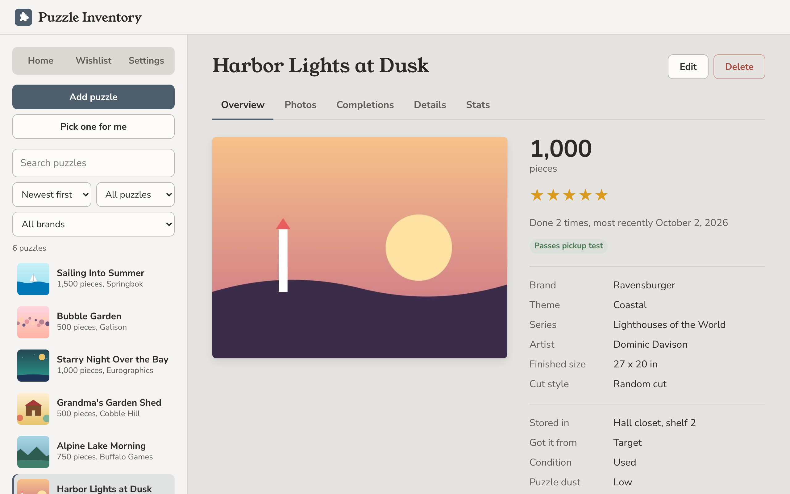
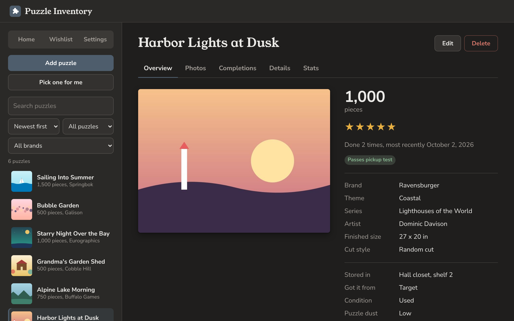
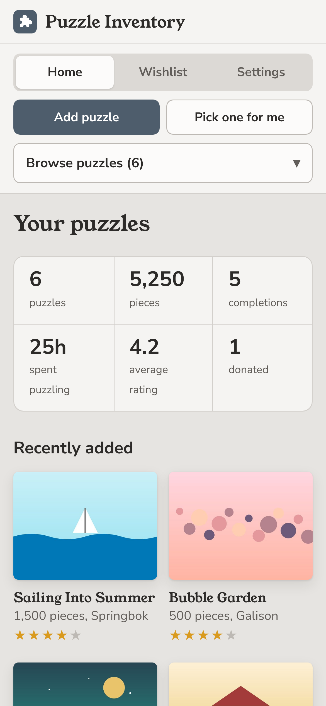

# Puzzle Inventory

A self-hosted app for keeping track of a jigsaw puzzle collection: what you own, where it's stored, how long each one took, and what's on the wishlist. It runs on a small Node.js server on your home network and keeps everything in plain JSON files, so there's no database to look after.

**Version:** SEHv1.06 ([changelog](CHANGELOG.md))


## What it does

- **Your collection:** name, brand, pieces, theme, series, artist, finished size, cut style, where it's stored and where it came from, plus your own custom fields
- **Photos:** several per puzzle, with a cover photo. Phone photos are turned the right way up, resized and compressed automatically.
- **Completions:** date, time taken (optional), rating and notes every time a puzzle is done
- **Condition:** missing pieces (and how many), puzzle dust, passes the pickup test, donated
- **Quality score:** rate fit, cut, image, thickness and six other things for a 0 to 100 score
- **Find things:** search by name, brand, theme, series or artist; sort and filter the list; your choices are remembered on each device
- **Pick one for me:** chooses a random puzzle, optionally within a piece range and skipping ones already done, donated or missing pieces
- **Wishlist:** with priority, price, where to buy and a link. **Got it** moves an item into the collection with its details filled in.
- **Export:** puzzles and wishlist to CSV for Excel or Google Sheets, and a full backup file
- **Looks:** warm or cool gray with a choice of accent colors, plus dark mode. Works on phones and can be added to the home screen like an app.

<table>
  <tr>
    <td width="66%">
      
      
    </td>
    <td></td>
  </tr>
</table>

## Try it on your computer

Needs [Node.js](https://nodejs.org) 20 or newer.

```bash
git clone https://github.com/RED-RED-RED/puzzle-inventory.git
cd puzzle-inventory
npm install
npm start
```

Open [http://localhost:3000](http://localhost:3000). Your data goes in `data/` and photos in `uploads/` inside the project folder.

## Install on a server

The installer works on Ubuntu or Debian: a Proxmox container, a VM or a regular machine.

### Proxmox container (recommended)

Create an **Ubuntu 24.04 CT**: unprivileged, nesting on (the default), 1 core, 1 GB RAM, 16 GB disk, and a static IP or DHCP reservation. Then in its console, as root:

```bash
apt update && apt install -y git curl
curl -fsSL https://deb.nodesource.com/setup_22.x | bash - && apt install -y nodejs
git clone https://github.com/RED-RED-RED/puzzle-inventory.git
cd puzzle-inventory
bash install.sh
```

On any other Ubuntu or Debian machine it's the same steps, with `sudo` in front of the `apt`, `bash` and `curl | bash` commands.

The installer:

- copies the app to `/opt/puzzle-inventory`
- runs it as its own `puzzle` user under systemd, so it starts on boot and restarts if it crashes
- sets up a nightly backup
- checks the app is answering, then prints the address to open

Options go in front of the command, for example `sudo PORT=8080 BACKUP_DIR=/mnt/nas/puzzles bash install.sh`:

| Option | Default |
|---|---|
| `PORT` | `3000` |
| `BACKUP_DIR` | `/var/backups/puzzle-inventory` |
| `APP_DIR` | `/opt/puzzle-inventory` |
| `APP_USER` | `puzzle` |

### Updating

Take a CT snapshot first so you can roll back in one click. Then:

```bash
cd puzzle-inventory
git pull
sudo bash install.sh
```

The installer updates the code and restarts the app. It never touches the data or photos. Pass the same options again if you used any.

### Day to day

```bash
sudo systemctl status puzzle-inventory      # is it running?
sudo systemctl restart puzzle-inventory     # restart it
sudo journalctl -u puzzle-inventory -f      # watch the logs
```

For uptime monitoring (Uptime Kuma or similar), use `http://<server>:3000/api/health`. It returns `200` when the app is up and its data is readable, and `503` if not.

## On a phone

Open the app's address in the phone's browser, then add it to the home screen:

- **iPhone:** Safari > Share > **Add to Home Screen**. It opens full screen with its own icon.
- **Android:** Chrome > menu > **Add to Home screen**. Over plain `http://` this is a shortcut that opens in a browser tab; a full-screen install needs HTTPS.

The phone has to be on your home network, or connected by VPN such as Tailscale. Over HTTPS, if the server can't be reached it shows a "can't reach the puzzle server" page instead of a browser error.

## Backups

There are two kinds, and they do different jobs.

**Nightly server backup (includes photos).** Every night at about 2:30 AM, `data/` and `uploads/` are archived to `/var/backups/puzzle-inventory/`. The last 14 are kept. This is the one to rely on.

```bash
sudo systemctl start puzzle-inventory-backup     # back up now
ls -lh /var/backups/puzzle-inventory/            # list backups
systemctl list-timers puzzle-inventory-backup    # next scheduled run
```

To restore one:

```bash
sudo systemctl stop puzzle-inventory
sudo tar -xzf /var/backups/puzzle-inventory/puzzle-inventory-<date>.tar.gz -C /opt/puzzle-inventory
sudo systemctl start puzzle-inventory
```

These archives sit on the same disk as the app. To survive a dead disk, keep them somewhere else: install with `BACKUP_DIR` pointing at a mounted NAS share (`sudo BACKUP_DIR=/mnt/nas/puzzles bash install.sh`), or copy them off with your normal backup tool.

**In-app backup (Settings > Download backup).** A JSON file with every puzzle, completion, custom field, wishlist item, setting and the appearance choices. It does not include the photo files. Restoring it replaces all current data in one step and first saves a copy of what was there to `data/pre-restore-<timestamp>/`. Photos come back on their own as long as the `uploads/` folder is still on the server.

## Security

There is no login. Anyone who can reach the app's port can see and change everything. Keep it on your home network, don't port-forward it, and use a VPN (Tailscale, WireGuard) to reach it from outside.

## How it's built

- **Server:** `server.js`, a small Express app. It serves the pages, handles the API, and processes photos with sharp.
- **Front end:** plain HTML, CSS and JavaScript in `public/`, with no build step. The fonts (Young Serif and Nunito Sans, SIL Open Font License) are included, so nothing loads from the internet.
- **Data:** JSON files in `data/`, photos in `uploads/puzzles/`.

Saves are built so a crash or two devices saving at once can't lose data:

- Every change is a locked read-modify-write, so saves from two devices can't overwrite each other.
- Files are written to a temp file, flushed to disk, then renamed into place. A power cut leaves either the old file or the new one, never half of one.
- If a data file is ever corrupt, the app refuses to save over it and won't start until it's fixed.

```
puzzle-inventory/
├── server.js                  # API, file storage, photo processing
├── install.sh                 # Install or update on Linux
├── deploy/                    # systemd service, nightly backup timer and script
├── public/
│   ├── index.html, app.js, styles.css
│   ├── fonts/, icons/
│   ├── manifest.webmanifest   # Home-screen app settings
│   ├── sw.js                  # Service worker (offline page only)
│   └── offline.html
├── tests/
│   ├── api/                   # Server tests (node:test)
│   ├── ui/                    # Browser tests (Playwright)
│   └── start-server.js        # Runs the app against throwaway folders
├── playwright.config.js
├── .github/workflows/test.yml # Runs the tests on every push
├── data/                      # Created when the app runs (not in git)
└── uploads/                   # Photos (not in git)
```

## Testing

```bash
npm install                            # includes the test tools
npx playwright install chromium        # one time: downloads the test browser
npm test                               # server tests, then browser tests
npm run test:api                       # server tests only, a few seconds
npm run test:ui                        # browser tests only
```

The tests need Node 22 or newer. They start their own copy of the app on port 3100 with empty temporary folders, so your real puzzles are never touched. GitHub runs the same tests on every push (the Actions tab). If a browser test fails there, the run has a `playwright-report` download showing what the browser saw.

The installer leaves the tests out of `/opt/puzzle-inventory` and doesn't install the test tools.

### Environment variables

| Variable | Default | |
|---|---|---|
| `PORT` | `3000` | Port to listen on |
| `HOST` | all interfaces | Address to listen on |
| `DATA_DIR` | `./data` | Data files |
| `UPLOADS_DIR` | `./uploads` | Photos |
| `UPLOAD_TMP_DIR` | system temp folder | Photos while they're being processed |

## API

Everything the app does goes through a JSON API, so it can be scripted. Errors come back as `{ "error": "message" }` with a matching HTTP status.

<details>
<summary>Endpoints</summary>

### Puzzles

| Method | Endpoint | Description |
|---|---|---|
| GET | `/api/puzzles` | List all puzzles |
| GET | `/api/puzzles/:id` | Get one puzzle |
| POST | `/api/puzzles` | Create a puzzle (`name` and `pieces` required) |
| PUT | `/api/puzzles/:id` | Update puzzle details |
| DELETE | `/api/puzzles/:id` | Delete a puzzle and its photos |

### Single-field updates

| Method | Endpoint | Body |
|---|---|---|
| PUT | `/api/puzzles/:id/notes` | `{ notes }` |
| PUT | `/api/puzzles/:id/condition` | `{ condition }` |
| PUT | `/api/puzzles/:id/passes-pickup` | `{ passesPickup }` |
| PUT | `/api/puzzles/:id/missing-pieces` | `{ missingPieces, missingPieceCount }` |
| PUT | `/api/puzzles/:id/puzzle-dust` | `{ puzzleDust }` |
| PUT | `/api/puzzles/:id/donated` | `{ donated }` |
| PUT | `/api/puzzles/:id/quality` | `{ ...quality ratings, qualityScore }` |

### Photos

| Method | Endpoint | Description |
|---|---|---|
| POST | `/api/puzzles/:id/images` | Upload up to 20 images, 25 MB each (multipart field `images`; optional `replaceIndex` with one image) |
| DELETE | `/api/puzzles/:id/images/:index` | Delete a photo |
| PUT | `/api/puzzles/:id/thumbnail` | `{ thumbnailIndex }` sets the cover photo |

### Completions

| Method | Endpoint | Description |
|---|---|---|
| POST | `/api/puzzles/:id/logs` | `{ date: "YYYY-MM-DD", time, rating, notes }`. `time` is in hours; 0 or left out means not timed. |
| PUT | `/api/puzzles/:id/logs/:logId` | Edit a completion (same fields) |
| DELETE | `/api/puzzles/:id/logs/:logId` | Delete a completion |

### Custom fields

| Method | Endpoint | Description |
|---|---|---|
| POST | `/api/puzzles/:id/custom-fields` | `{ name, value }` (both required) |
| DELETE | `/api/puzzles/:id/custom-fields/:fieldId` | Delete a custom field |

### Wishlist

| Method | Endpoint | Description |
|---|---|---|
| GET | `/api/wishlist` | List wishlist items |
| POST | `/api/wishlist` | Add an item (`name` required) |
| PUT | `/api/wishlist/:id` | Update an item |
| DELETE | `/api/wishlist/:id` | Delete an item |

### Settings, appearance, restore, health

| Method | Endpoint | Description |
|---|---|---|
| GET | `/api/settings` | Brand, theme and series lists |
| PUT | `/api/settings` | Replace all three lists |
| POST | `/api/settings/:list` | `{ value }` adds to `brands`, `themes` or `series` |
| DELETE | `/api/settings/:list` | `{ value }` removes from that list |
| GET | `/api/theme` | Appearance |
| PUT | `/api/theme` | `{ primary: "#rrggbb", tone: "warm" or "cool" }` (`primary` is the accent color) |
| POST | `/api/restore` | Replace all data from an in-app backup file. Current data is copied to `data/pre-restore-*` first; a backup with no wishlist keeps the current one. |
| GET | `/api/health` | `200` when up and data is readable, `503` otherwise |

</details>

## License

MIT. See [LICENSE](LICENSE).
