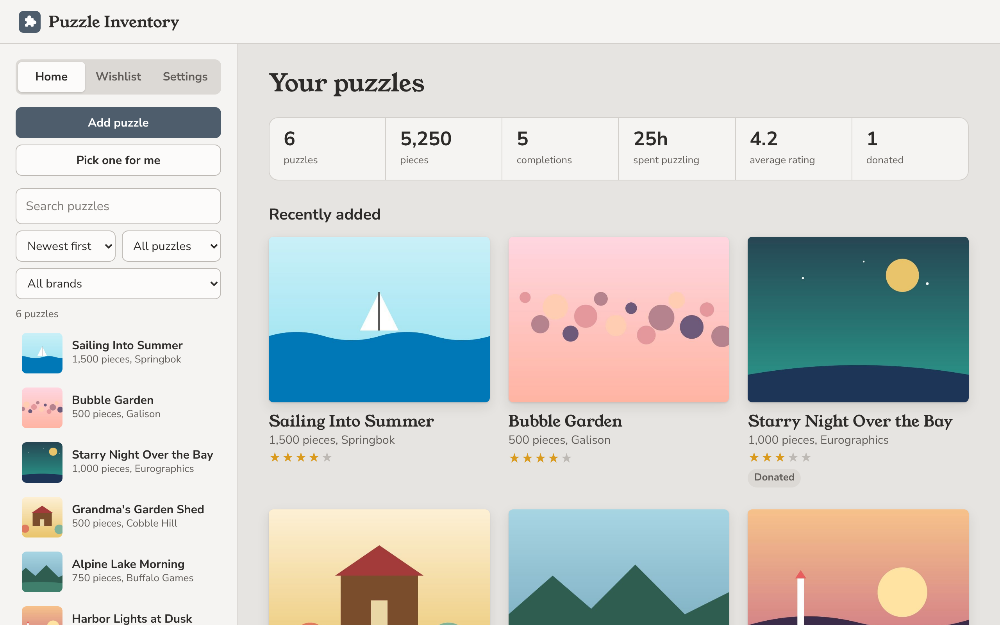

# 🧩 Puzzle Inventory App

A web-based inventory system for tracking jigsaw puzzles. Runs on Node.js with a small Express server and stores everything as JSON files, so there is no database to manage.

**Version:** SEHv1.04

---



---

## Quick Start (try it locally)

```bash
npm install
npm start
```

Open [http://localhost:3000](http://localhost:3000).

---

## Deploying on Linux (recommended)

Requires Node.js 18 or newer. On Ubuntu:

```bash
curl -fsSL https://deb.nodesource.com/setup_22.x | sudo -E bash -
sudo apt-get install -y nodejs
```

Then, from a normal user account (not root):

```bash
git clone https://github.com/RED-RED-RED/puzzle-inventory.git
cd puzzle-inventory
sudo bash install.sh
```

This installs the app to `/opt/puzzle-inventory`, runs it as your user under systemd (starts on boot, restarts on crash), and sets up a nightly backup. The script prints the address to open when it finishes.

### Updating

```bash
cd puzzle-inventory
git pull
sudo bash install.sh
```

Re-running the installer updates the code and restarts the app. It never touches `data/` or `uploads/` in the install folder.

### Managing the service

```bash
sudo systemctl status puzzle-inventory      # is it running?
sudo systemctl restart puzzle-inventory     # restart
sudo journalctl -u puzzle-inventory -f      # live logs
```

To use a different port, edit `Environment=PORT=3000` in `/etc/systemd/system/puzzle-inventory.service`, then `sudo systemctl daemon-reload && sudo systemctl restart puzzle-inventory`.

---

## Backups

There are two kinds, and they do different jobs.

**Nightly server backup (photos included).** A systemd timer archives `data/` and `uploads/` every night at about 2:30 AM to `/var/backups/puzzle-inventory/`, keeping the last 14. This is the one to rely on.

```bash
sudo systemctl start puzzle-inventory-backup     # run a backup now
ls -lh /var/backups/puzzle-inventory/            # see backups
systemctl list-timers puzzle-inventory-backup    # next scheduled run
```

To restore one:

```bash
sudo systemctl stop puzzle-inventory
sudo tar -xzf /var/backups/puzzle-inventory/puzzle-inventory-<date>.tar.gz -C /opt/puzzle-inventory
sudo systemctl start puzzle-inventory
```

These archives live on the same disk as the app. For real protection, copy them somewhere else (a NAS, another machine, cloud storage). The simplest way is to install with `BACKUP_DIR` pointing at a mounted network share: `sudo BACKUP_DIR=/mnt/nas/puzzles bash install.sh`.

**In-app backup (Settings > Download Backup).** Downloads a JSON file with all puzzle data, logs, custom fields, wishlist, settings and theme. It does not include the photo files themselves. Restoring it replaces all current data in one step and saves a copy of what was there to `data/pre-restore-<timestamp>/` first. Photos reappear automatically if the `uploads/` folder is still on the server.

---

## Features

- **Puzzle management**: name, brand, piece count, theme, series/set, artist, finished size, cut style, location and source
- **Photos**: upload several per puzzle, pick a thumbnail, rotate, replace or delete. Phone photos are auto-rotated, resized to 1200px and compressed. JPEG, PNG, WebP and GIF are supported, up to 25 MB each.
- **Completion logs**: date, time taken (optional), rating and notes for every completion. Edit or delete any entry.
- **Ratings**: 1 to 5 stars per puzzle and per completion
- **Puzzle Quality Score**: a 10-metric weighted score (0 to 100)
- **Status flags**: condition, passes pickup test, missing pieces, puzzle dust level, donated
- **Wishlist** with priority, price and product link
- **Custom fields**: any extra name/value pairs per puzzle
- **Search, sort and filter**: search by name, brand, theme, series or artist; sort by newest, name, pieces, rating, quality score or last completed; filter by status or brand
- **Pick One for Me**: picks a random puzzle, optionally limited by piece count and skipping completed, donated or incomplete puzzles
- **Wishlist to collection**: "Got It" moves a wishlist item into the collection with its details filled in
- **CSV export** of puzzles and wishlist for Excel, Numbers or Google Sheets
- **Statistics** for each puzzle and across the collection
- **Themeable** colors and dark mode
- **Managed dropdowns** for brands, themes and series/sets, editable in Settings

---

## Project Structure

```
puzzle-inventory/
├── server.js                  # Express server: API, file storage, image processing
├── package.json
├── install.sh                 # Install/update on Linux with systemd
├── deploy/
│   ├── puzzle-inventory.service          # App service template
│   ├── puzzle-inventory-backup.service   # Backup job template
│   ├── puzzle-inventory-backup.timer     # Nightly schedule
│   └── backup.sh                         # Archives data/ and uploads/
├── public/
│   ├── index.html             # Frontend UI
│   └── app.js                 # Frontend logic
├── data/                      # Created at runtime (not in git)
│   ├── puzzles.json
│   ├── settings.json
│   ├── wishlist.json
│   └── theme.json
└── uploads/puzzles/           # Uploaded photos (not in git)
```

### How data is kept safe

- Every change is a locked read-modify-write, so simultaneous saves from two devices cannot overwrite each other.
- Files are written to a temp file, flushed to disk, then renamed into place. A crash or power cut leaves either the old file or the new one, never a half-written one.
- If a data file is ever corrupt, the app refuses to save over it and will not start until it is fixed, so nothing is silently lost.

---

## Security note

There is no login. Anyone who can reach port 3000 can view and change the data. Keep it on a trusted home network and do not port-forward it to the internet. If you need remote access, use a VPN (WireGuard, Tailscale) rather than exposing the port.

---

## API Reference

All endpoints return JSON. Errors come back as `{ "error": "message" }` with an appropriate HTTP status.

### Puzzles

| Method | Endpoint | Description |
|--------|----------|-------------|
| GET | `/api/puzzles` | List all puzzles |
| GET | `/api/puzzles/:id` | Get one puzzle |
| POST | `/api/puzzles` | Create a puzzle (name and pieces required) |
| PUT | `/api/puzzles/:id` | Update puzzle details |
| DELETE | `/api/puzzles/:id` | Delete a puzzle and its photos |

### Images

| Method | Endpoint | Description |
|--------|----------|-------------|
| POST | `/api/puzzles/:id/images` | Upload up to 20 images (multipart, field `images`; optional `replaceIndex` with one image) |
| DELETE | `/api/puzzles/:id/images/:index` | Delete an image by index |
| PUT | `/api/puzzles/:id/thumbnail` | `{ thumbnailIndex }` |

### Completion Logs

| Method | Endpoint | Description |
|--------|----------|-------------|
| POST | `/api/puzzles/:id/logs` | `{ date: "YYYY-MM-DD", time, rating, notes }`. `time` is in hours; 0 or omitted means not timed. |
| PUT | `/api/puzzles/:id/logs/:logId` | Edit a log entry (same fields) |
| DELETE | `/api/puzzles/:id/logs/:logId` | Delete a log entry |

### Single-field updates

| Method | Endpoint | Body |
|--------|----------|------|
| PUT | `/api/puzzles/:id/notes` | `{ notes }` |
| PUT | `/api/puzzles/:id/condition` | `{ condition }` |
| PUT | `/api/puzzles/:id/passes-pickup` | `{ passesPickup }` |
| PUT | `/api/puzzles/:id/missing-pieces` | `{ missingPieces, missingPieceCount }` |
| PUT | `/api/puzzles/:id/puzzle-dust` | `{ puzzleDust }` |
| PUT | `/api/puzzles/:id/donated` | `{ donated }` |
| PUT | `/api/puzzles/:id/quality` | `{ ...quality metrics, qualityScore }` |

### Custom Fields

| Method | Endpoint | Description |
|--------|----------|-------------|
| POST | `/api/puzzles/:id/custom-fields` | `{ name, value }` (both required) |
| DELETE | `/api/puzzles/:id/custom-fields/:fieldId` | Delete a custom field |

### Wishlist

| Method | Endpoint | Description |
|--------|----------|-------------|
| GET | `/api/wishlist` | List all wishlist items |
| POST | `/api/wishlist` | Add an item (name required) |
| PUT | `/api/wishlist/:id` | Update an item |
| DELETE | `/api/wishlist/:id` | Delete an item |

### Settings, Theme, Restore

| Method | Endpoint | Description |
|--------|----------|-------------|
| GET | `/api/settings` | Brands, themes and series lists |
| PUT | `/api/settings` | Save settings |
| GET | `/api/theme` | UI colors |
| PUT | `/api/theme` | `{ primary: "#rrggbb", secondary: "#rrggbb" }` |
| POST | `/api/restore` | Replace all data from an in-app backup file (current data is copied to `data/pre-restore-*` first) |

---

## Changelog

### SEHv1.04 - 2026-11-15
**New features:**
- Wishlist "Got It" button opens Add Puzzle pre-filled from the wishlist item and removes it from the wishlist once saved
- "Pick One for Me" chooses a random puzzle, with optional piece range and options to skip completed, donated or incomplete puzzles
- Sort and filter the puzzle list (sort by newest, oldest, name, pieces, rating, quality score, recently completed, most completed; filter by not done, completed, donated, missing pieces, passes pickup test, or brand). Choices are remembered per browser.
- New puzzle fields: artist, finished size, cut style, and how many pieces are missing
- Export puzzles or wishlist to CSV from Settings (opens cleanly in Excel, including accented characters)
- Search now also matches artist

### SEHv1.03 - 2026-11-15
**Data safety:**
- Simultaneous saves could silently drop changes (in testing, only 4 of 20 parallel saves survived). All writes are now serialized through a lock.
- A corrupt or unreadable data file was treated as empty, so the next save wiped the collection. The app now refuses to overwrite it and will not start until it is fixed.
- Restoring a backup discarded every completion log and custom field and deleted all photo files. Restore is now a single server-side step that keeps logs, custom fields, quality scores and photo references, and saves the previous data first.
- Data files are flushed to disk before being swapped in, so a power cut cannot leave a half-written file.
- Re-running `install.sh` to update could copy an empty `data/` folder over the real one. The installer now never copies `data/` or `uploads/`.
- IDs are guaranteed unique even when created in the same millisecond.

**Bug fixes:**
- Completion dates showed one day early, and the default date jumped to tomorrow in the evening (UTC vs local time).
- Changing notes on the Additional Info tab and then using Edit Puzzle could revert the notes to the old value.
- A just-added completion log could not be edited until the page was reloaded.
- Quality score selections from the previously viewed puzzle carried over and could be saved to the next one.
- If the initial completion log failed when adding a puzzle, the form stayed open and saving again created a duplicate puzzle.
- Photos picked while editing a puzzle were silently ignored; they are now uploaded.
- Phone photos could appear sideways; they are now auto-rotated.
- Upload errors (file too large, unsupported format) returned an HTML error page instead of a readable message.
- Average ratings counted unrated puzzles and logs as 0 stars.
- Brand, theme or series names containing quotes broke their Delete button, and were not escaped in Settings or dropdowns.
- Search now includes series and keeps the filter when the list refreshes.

**Changes:**
- Logging a completion without a time is now allowed and shows as "Not timed"; it is left out of average and fastest time.
- Image limit raised to 25 MB each, 20 per upload.
- Nightly backup timer for data and photos (`deploy/`), with 14 days kept.
- Installer detects Node (including nvm installs), checks the version, and works as an updater.
- Removed unused PQI code and the `/api/puzzles/:id/pqi` endpoint (the Quality Score section is the one in use).
- `PORT` and `HOST` can be set by environment variable.

### SEHv1.02 - 2026-03-11
**Bug fixes:**
- Completion log ratings were always saved as 0 — star rating input is now wired up correctly for both new logs and the initial log on puzzle creation
- Added missing star rating UI to the completion log modal and initial log section
- Rating is now correctly restored when editing an existing log entry
- Custom fields always failed with a 400 error — server was expecting a field named `label` but the client was sending `name`; both sides now use `name`
- Thumbnail index could go out of bounds after deleting an image (especially if the deleted image came before the thumbnail); server now clamps the index after deletion, and the client renders defensively as well
- Image upload errors were silently treated as success; the handler now checks the response status and shows an error alert on failure
- XSS: added `escapeHtml()` and applied it to all user-supplied data rendered into the page (puzzle names, brands, themes, notes, custom field values, wishlist fields, etc.)
- Wishlist product links are now only rendered as clickable anchors if the URL starts with `http://` or `https://`, preventing `javascript:` URL injection
- Image gallery onclick handlers no longer inject image URLs directly into HTML attribute strings; they now use index-based lookup to avoid attribute injection

**New features:**
- Dark mode toggle added to Settings → Theme section; preference is saved in `localStorage` and persists across sessions

### SEHv1.01 - initial release
- Initial public release
